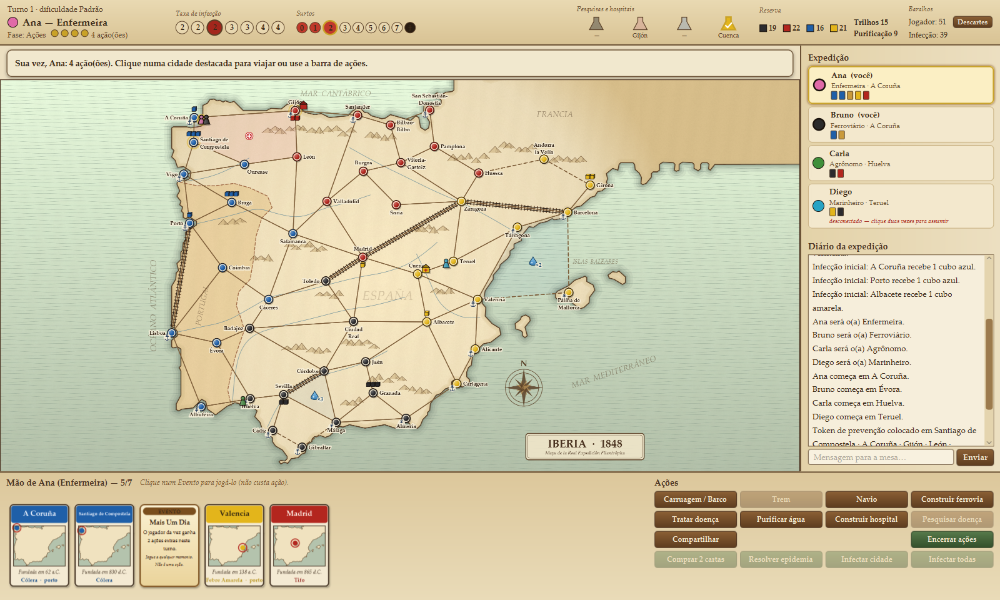

# Iberia 1848 — clone de *Pandemic: Iberia* em Java

Clone desktop, cooperativo e em rede local (LAN) do jogo de tabuleiro **Pandemic: Iberia** (Z-Man Games, 2016),
feito em **Java 17+ / JavaFX 21** com servidor **autoritativo** sobre TCP e mensagens JSON (Gson).



> Projeto pessoal/educacional. A arte é toda gerada por código (cartografia sépia desenhada no `Canvas`);
> nenhuma imagem do jogo original é distribuída. O mapa (cidades, cores, portos e as 81 linhas) foi
> transcrito do tabuleiro mostrado no manual oficial e conferido com os exemplos do próprio manual.

## Como rodar

Requisitos: **JDK 17+** (testado com Temurin 21) e **Maven 3.9+**. As dependências (JavaFX, Gson, JUnit)
são baixadas pelo Maven.

> Neste computador o `java` do PATH é o 1.8; aponte o `JAVA_HOME` para o JDK 21 antes de usar o Maven.

```bash
mvn javafx:run
```

```bash
mvn package
```

```bash
java -jar target/pandemic-iberia-1.0.0-all.jar
```

```bash
java -jar target/pandemic-iberia-1.0.0-all.jar --server 8080
```

- `mvn javafx:run` abre o jogo direto do código-fonte.
- `mvn package` roda os testes e gera o jar executável `target/pandemic-iberia-1.0.0-all.jar` (JavaFX embutido para Windows).
- `--server [porta]` sobe um servidor dedicado sem interface; o primeiro jogador a entrar vira o anfitrião.

## Jogando em rede local

1. **Hospedar partida**: escolha a porta (padrão `8080`). O servidor roda dentro do seu próprio processo e
   seu cliente se conecta a ele por TCP como qualquer outro. O saguão mostra os IPs da máquina.
2. **Entrar na partida**: digite o IP e a porta do anfitrião, ou use **Procurar na rede local**
   (descoberta por broadcast UDP na porta `47848`).
3. No **saguão**: cada jogador escolhe um papel (ou "aleatório") e marca *pronto*; o anfitrião define a
   dificuldade (4, 5 ou 6 Epidemias) e o desafio opcional **Doenças Históricas**, e inicia.
4. **Jogar sozinho / hot-seat**: "Adicionar jogador local" cria assentos extras controlados pelo mesmo
   computador (o Pandemic exige ao menos 2 papéis).
5. Se alguém cair, basta reconectar com **o mesmo nome**. Outro jogador também pode assumir um assento
   desconectado (duplo clique no painel *Expedição*).

### Interface

- **Mapa**: clique numa cidade destacada para viajar (menu com Carruagem/Barco, Trem e Navio); roda do mouse
  dá zoom, arrastar move o mapa, duplo clique reseta. Passe o mouse numa cidade para ver cubos, hospital e peões.
- **Barra de ações**: os botões só ficam ativos quando a ação é legal (a UI usa o mesmo `RuleValidator` do servidor).
  Ações que pedem escolha (região, linha, cidade) destacam as opções no mapa; `Esc` cancela.
- **Cartas**: as mãos são públicas (como no jogo). Clique num Evento para jogá-lo a qualquer momento;
  quando passar de 7 cartas, clique numa carta para descartar.
- **Pedidos de consentimento**: Compartilhar Conhecimento, levar passageiro e eventos que movem peões ou
  trocam cartas de outro jogador pedem "Aceitar/Recusar" a ele.
- **Diário**: registra ações, compras, infecções, surtos, epidemias e o chat.

## Regras implementadas

Segue o manual de *Pandemic: Iberia*:

- 48 cidades em 4 cores — **Malária (preta), Tifo (vermelha), Cólera (azul), Febre Amarela (amarela)** —,
  19 portos, 6 linhas tracejadas (Andorra la Vella, Palma de Mallorca, Gibraltar) que não aceitam ferrovia.
- **34 regiões** calculadas automaticamente como as faces do grafo planar de linhas (inclui a região de mar
  Barcelona–Tarragona–Valencia–Palma citada no manual).
- Preparação: 9 cidades infectadas (3×3, 3×2, 3×1), eventos e mão inicial pelo número de jogadores, pilhas com
  1 Epidemia cada (menores embaixo), cidade inicial escolhida entre as cartas, primeiro jogador = cidade fundada
  há mais tempo.
- Ações: Carruagem/Barco, Trem, Navio, Construir Ferrovia (20), Construir Hospital (1 por cor, move se já
  existir), Tratar Doença (sempre 1 cubo), Compartilhar Conhecimento, Pesquisar (5 cartas no hospital da cor) e
  Purificar Água (2 fichas; 14 na reserva).
- Fichas de purificação anulam cubos um a um nas cidades vizinhas à região; se houver mais de uma região com
  fichas, **o jogador da vez escolhe** de qual remover (a resolução pausa e continua depois).
- Infecção carta a carta, surtos em cadeia (cada cidade 1 vez por carta), Epidemia (Aumentar, Infectar 3 com
  o fundo do baralho, Intensificar), duas Epidemias juntas com pausa para Eventos.
- Limite de mão (7) a qualquer momento; derrota por 8 surtos, falta de cubos ou falta de cartas; vitória ao
  pesquisar as 4 doenças.
- Os **7 papéis** e os **15 Eventos** do jogo.
- Desafio opcional **Doenças Históricas** (as 4 doenças, ativáveis individualmente).

Onde o prompt original divergia do manual, valeu o manual: pesquisa com **5** cartas (não 4), Tratar remove
**1** cubo mesmo após pesquisada, mapeamento de cores acima, e os poderes dos papéis conforme as cartas
oficiais. O desafio *Influx of Patients* não foi implementado.

## Arquitetura

```
src/main/java/com/iberia
├── Main.java / Launcher.java     entrada JavaFX (Hospedar/Entrar) e servidor dedicado
├── model/    dados puros e serializáveis: City, Route, Region, Board(+BoardData), DiseaseType,
│             PlayerCard, InfectionCard, Hospital, Role, EventType, Player, GameState, GameAction…
├── engine/   regras determinísticas: GameEngine (fachada), RuleValidator, TurnManager,
│             EpidemicResolver, GameSetup
├── network/  GameServer (autoritativo), GameClient, Packet/PacketType, NetworkEventListener,
│             LanDiscovery (UDP), Json
└── ui/       BoardCanvas, GameScreen, LobbyScreen, MainMenuScreen, PlayerHandView,
              ActionControlsView, HudView, PlayersPanel, LogView, CardView, Dialogs, Theme, MapGeometry
```

- **Model/Engine** não conhecem JavaFX nem rede. Todo comando passa por `GameEngine.apply(GameAction)`:
  validação → consentimento dos afetados (se preciso) → execução → fluxo do turno.
- **Servidor autoritativo**: uma única thread processa os pacotes em ordem; só o dono de um assento pode
  agir por ele; ações ilegais voltam como `ERROR` só para quem enviou; cada ação aceita gera um
  `STATE_BROADCAST` com o estado canônico, com a ordem dos baralhos ocultada.
- **Protocolo** (uma linha JSON por pacote, `{"type": ..., "data": {...}}`): `CONNECT`, `WELCOME`,
  `LOBBY_UPDATE`, `LOBBY_COMMAND`, `GAME_START`, `PLAYER_ACTION`, `STATE_BROADCAST`, `CHAT_MESSAGE`,
  `ERROR`, `DISCONNECT`.

## Testes

`mvn test` executa 24 testes:

- `BoardTest`: contagens do mapa e os exemplos do manual (vizinhos de Albufeira/Cuenca/Valencia, seis regiões
  em Zaragoza, região ao norte de Barcelona).
- `EngineTest`: preparação, purificação e escolha de ficha, surto em cadeia do exemplo do manual, Enfermeira,
  Epidemia, Cólera e Febre Amarela históricas, movimentos, papéis, consentimento, limite de mão, eventos e 25
  partidas completas jogadas por bots aleatórios.
- `NetworkTest`: servidor + clientes TCP reais (saguão, início, autorização, rejeição de jogada ilegal, chat,
  reconexão) e descoberta UDP.

Ferramentas de desenvolvimento em `src/test/java/com/iberia/ui`: `SnapshotTool` (gera PNGs das telas) e
`UiSmokeTool` (renderiza partidas inteiras de bots na tela de jogo para caçar exceções).
